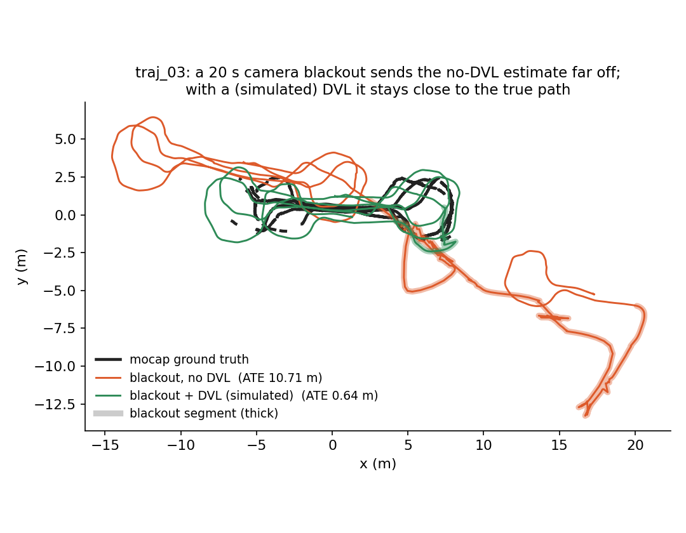
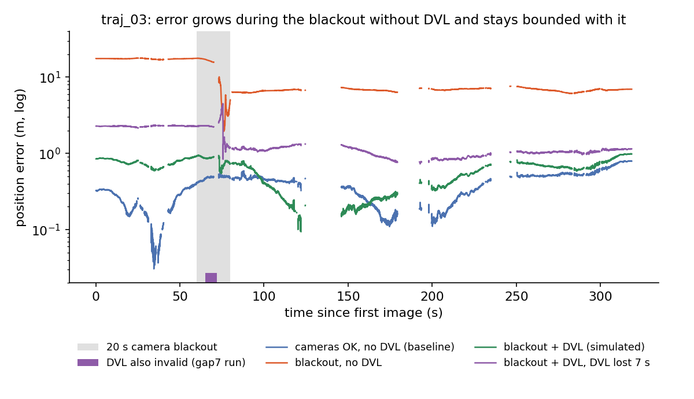
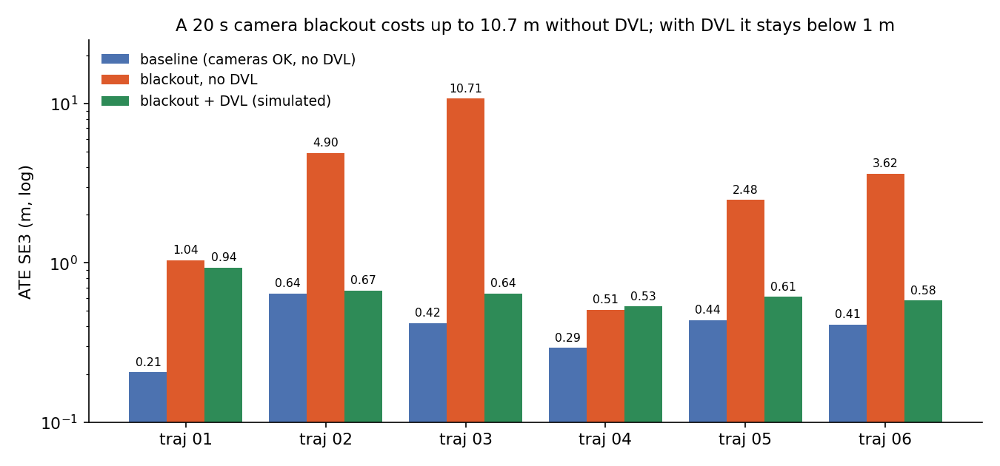
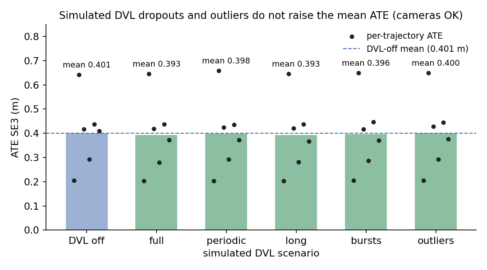
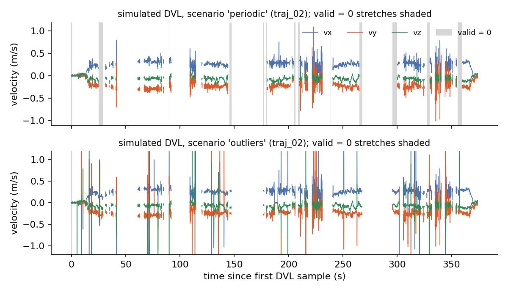

# uw-vio-dvl: underwater stereo-inertial-pressure VIO with a tightly coupled DVL that survives dropouts

`uw_ct_vio` is a GTSAM fixed-lag (iSAM2) estimator for underwater vehicles: IMU preintegration, stereo
projection factors from a photometrically robust KLT front end (auto local-contrast normalisation for dark /
turbid images), a continuous-time pressure-depth factor, and a **DVL body-velocity factor** with validity,
innovation-gate, re-lock and recovery logic so DVL dropouts (bottom-lock loss, water-column lock, spikes) do
not corrupt the estimate. Offline runner `run_bag` replays ROS 2 bags. Research code; never run on a vehicle.



*traj_03 (NTNU underwater 2023, subset-3), x-y after hand-eye + SE3 alignment as in `scripts/evaluate.py`; thick
segments mark the 20 s camera blackout. The DVL is simulated from mocap, so this shows the factor and gating, not real-sensor accuracy.*

## Results (NTNU underwater dataset 2023, 6 trajectories with mocap; mean ATE SE3 with hand-eye, RPE over 5 m)

| Configuration | Mean ATE (m) | Mean RPE (%) | Worst traj (m) |
|---|---|---|---|
| VIO + pressure, cameras normal (base) | 0.401 | 6.75 | 0.642 |
| + DVL (sim), no dropouts | 0.393 | 6.71 | 0.646 |
| + DVL (sim), periodic / long / burst dropouts, outliers | 0.393-0.400 | 6.71 | 0.658 |
| 20 s camera blackout, **no DVL** | 3.876 | 33.81 | 10.711 |
| 20 s camera blackout, **DVL (sim)** | **0.663** | 7.31 | 0.936 |
| 20 s camera blackout, DVL also lost for 7 s inside it | 0.888 | 9.39 | 1.527 |

**The DVL is simulated** (`scripts/sim_dvl.py`, from mocap, with noise, scale bias, a ~2.5 deg mount error from
the hand-eye calibration, dropouts and outliers). These numbers show the factor, gate and dropout handling
work; real-sensor accuracy needs a real DVL dataset (e.g. the Heriot-Watt Tank dataset). Baselines on the same
bags: Basalt 1.10 m (in-air stereo extrinsic), SVIn 1.80 m, ORB-SLAM3 initialises on 3/6, OpenVINS 3/6.
Details, design, as-built notes and the full table: `DESIGN_DVL.md`. Estimator history and ablations:
`DESIGN_V2.md`, `DESIGN_PHASE2.md`.

### Figures



*Position error vs time on traj_03 (log scale). Errors are after the same global SE3 alignment that gives the reported ATE, so a
late blackout drift also shows up as offset before it; the DVL-lost-for-7 s run is the purple curve. Simulated DVL.*



*ATE per trajectory (log axis): baseline, 20 s blackout without DVL, and with simulated DVL. Values from the table above (`ntnu_all.tsv` of the benchmark runs). On traj_01 and traj_04 the DVL gives little or no gain.*



*Mean ATE per simulated DVL scenario with cameras normal; dots are the 6 trajectories. The means are not above DVL-off, but
single trajectories can be slightly worse (worst 0.658 m vs 0.642 m).*



*Example simulated DVL velocity (body frame, traj_02), periodic dropouts and outliers; samples exist only where mocap does. Outlier spikes are clipped to +-1.2 m/s.*

Regenerate all figures (needs matplotlib, numpy and the run outputs; paths are for our machine):
```bash
python3 scripts/make_figures.py --data <uw_figdata> --mocap-root <results>/ws1_sync/mocap
```

## Build

GTSAM 4.2.0 with `GTSAM_BUILD_UNSTABLE=ON` installed to a prefix, ROS 2 Jazzy (rosbag2, geometry_msgs,
sensor_msgs), OpenCV 4, Eigen 3. Source ROS from **bash** (zsh leaves PYTHONPATH unset).

```bash
source /opt/ros/jazzy/setup.bash
colcon build --base-paths uw_ct_vio --cmake-args -DCMAKE_BUILD_TYPE=Release \
  -DGTSAM_DIR=$GTSAM_PREFIX/lib/cmake/GTSAM -DGTSAM_UNSTABLE_DIR=$GTSAM_PREFIX/lib/cmake/GTSAM_UNSTABLE -DBUILD_TESTING=ON
export LD_LIBRARY_PATH=$GTSAM_PREFIX/lib:$LD_LIBRARY_PATH
colcon test --packages-select uw_ct_vio && colcon test-result --verbose   # test_estimator_dvl takes ~4 min
python3 -m pytest -q scripts/test_sim_dvl.py
```

## Run (NTNU example)

```bash
C=<ntnu>/calibration
run_bag --bag <ntnu>/traj_01/traj_01_ros2 \
  --intrinsics $C/stereo_intrinsics_under_water/camchain-ariel_stereo_underwater.yaml --stereo-from-intrinsics 1 \
  --imucam $C/stereo_extrinsics_above_water/camchain-imucam-ariel_stereo_extrinsics_above_water.yaml \
  --imu-yaml <imu noise yaml> --left cam1 --right cam0 \
  --left-topic /alphasense_driver_ros/cam1 --right-topic /alphasense_driver_ros/cam0 \
  --imu-topic /alphasense_driver_ros/imu --pressure-topic /mavros/imu/static_pressure \
  --lcn 2 --lcn-stereo 0 --huber-k 0.5 \
  [--dvl-file dvl.csv --dvl-extrinsic dvl.yaml | --dvl-topic /dvl/twist] [--vision-blackout 60:20] \
  [--frame-log frames.csv] --out traj_01.tum
python3 scripts/sim_dvl.py <mocap.tum> --hand-eye-est <reference est.tum> --imucam <imucam.yaml> --cam cam1 \
  --scenario none|periodic|long|bursts|outliers --out dvl.csv
python3 scripts/evaluate.py <mocap.tum> traj_01.tum --hand-eye --hand-eye-first-s 60
```
`scripts/dvl_bench_ws1.sh` is the 6-trajectory benchmark runner used for the table (paths for our machine;
set `UWVIO`, `DATA`, `RUNNER`).

## Not validated

Real DVL data; the `--dvl-topic` reader; DVL extrinsic / scale / time-offset estimation; vehicle runs.
An independent code review of the DVL change was started and not completed.

Licence: none yet (choose before publishing).
